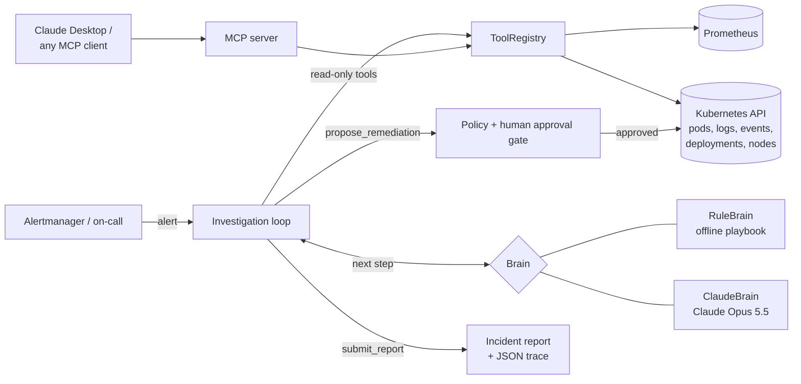

# KubeSleuth

**An agentic SRE for Kubernetes.** When an alert fires, KubeSleuth investigates the cluster on its own (pods, crash logs, events, rollout history, Prometheus metrics), works out the root cause, and proposes one fix that **waits for a human to approve it**. It finishes with a structured incident report.

It runs on Claude through the Anthropic SDK. It also ships with a deterministic playbook brain, so you can run, test and demo the full loop offline with no API key and no cluster.

```text
▲ HighHTTP5xxRate  [critical]  deployment/search-api in namespace api
   5xx rate for search-api is 18.2% (SLO: < 1%) for the last 8 minutes.

◆ thinking
   All 2 pods are running and ready, so the problem may be above the pod level. ...
  → list_pods(namespace="api", owner="deployment/search-api")
  → describe_pod(...)  → get_events(...)  → get_pod_logs(...)  → get_deployment(...)
  → query_metric(metric="http_5xx_rate", ...)  → query_metric(metric="http_p99_latency", ...)

⚑ Approval needed: rollback_deployment api/search-api (to_revision=21)  risk=low
  ✓ approved
  Error rate dropped back under the SLO within 3 minutes of rolling back to revision 21.

━━ Incident report ━━━━━━━━━━━━━━━━━━━━━━━━━━━━━━━━━━━━━━━━━━━━━━━━━━━━━━━━━━━━
  status      resolved
  category    BadRollout
  Root cause  The error rate rose from 0.3% to 18.2% immediately after revision 22
              ("fail fast: RANKING_TIMEOUT_MS=200, retries=0"). Logs show: upstream
              timeout calling ranking-svc after 200ms (attempt 1/1)
```

## Why it's built this way

| Decision | Why |
|---|---|
| **Read-only by default** | Every investigation tool is read-only. The agent's RBAC role can't read Secrets, so credentials never reach the model. |
| **One change, human-approved** | `propose_remediation` is routed to an approval gate, not executed. A policy layer rejects anything outside an allowlist (`rollback_deployment`, `patch_memory_limit`, `restart_deployment`, `scale_deployment`, `cordon_node`) or in `kube-system`. If the approver crashes, that counts as a rejection. |
| **One tool surface, two front doors** | The same tool definitions are sent to Claude and served over **MCP**, so Claude Desktop, Claude Code or any MCP client can investigate with them. |
| **Pluggable brains** | `RuleBrain` (an SRE playbook, offline) and `ClaudeBrain` (Claude Opus 5.5 with adaptive thinking) share one interface. The rule brain is the baseline the LLM is evaluated against. |
| **Evals built in** | Each scenario records its ground-truth root cause and fix. `kubesleuth eval` scores diagnosis accuracy, resolution rate and tool calls. |
| **Append-only conversation** | The Claude brain passes assistant content back exactly as returned, which keeps thinking blocks valid and the prompt cache warm. |

## Architecture



## Quick start

```bash
git clone https://github.com/sudhaseeli/kubesleuth && cd kubesleuth
python -m venv .venv && source .venv/bin/activate   # Windows: .venv\Scripts\activate
pip install -e ".[dev]"

kubesleuth scenarios                                  # list the bundled incidents
kubesleuth investigate --scenario oom-kill            # offline; you approve the fix
kubesleuth eval --brain rules                         # score every scenario
pytest -q
```

### With Claude

```bash
pip install -e ".[claude]"
export ANTHROPIC_API_KEY=...                          # or `ant auth login`
kubesleuth investigate --scenario readiness-probe --brain claude
kubesleuth eval --brain claude --json results.json
```

The Claude brain uses `claude-opus-5-5` with adaptive thinking (`--effort high` by default) and server-side refusal fallbacks enabled. Change the model with `--model` and the effort with `--effort`. Token usage, including prompt-cache reads, is printed after each run.

### On a real cluster

```bash
pip install -e ".[claude,live]"
kubectl apply -f deploy/rbac.yaml                     # read-only ClusterRole
kubesleuth investigate --live --brain claude \
  --namespace shop --target deployment/checkout-api \
  --prometheus http://localhost:9090                  # e.g. via kubectl port-forward
```

Approved fixes only touch the cluster with `--allow-writes`, and they also need the namespaced `kubesleuth-remediator` role. `deploy/investigate-job.yaml` runs a diagnose-only investigation as an in-cluster Job.

### As an MCP server

```bash
pip install -e ".[mcp]"
kubesleuth mcp --scenario oom-kill                    # or --live --namespace ... --target ...
```

Claude Desktop config:

```json
{ "mcpServers": { "kubesleuth": { "command": "kubesleuth", "args": ["mcp", "--scenario", "oom-kill"] } } }
```

Only the read-only tools are exposed over MCP. Remediation stays behind the agent's approval gate.

## Bundled incidents

| Scenario | What's going on | Expected fix |
|---|---|---|
| `oom-kill` | A cache preload pushed memory past a 256 MiB limit; pods are OOMKilled | `patch_memory_limit` |
| `crashloop-config` | A secrets migration renamed the config key the worker needs; it exits on startup | `rollback_deployment` |
| `image-pull` | Rollout references tag `v2.31.O` (letter O), which doesn't exist; rollout stuck | `rollback_deployment` |
| `bad-rollout-5xx` | Pods are healthy, but a new 200 ms upstream timeout sits below the upstream's p99; 18% 5xx | `rollback_deployment` |
| `disk-pressure` | A debug-level DaemonSet filled one node's disk; the kubelet keeps evicting pods there | `cordon_node` |
| `readiness-probe` | The readiness probe moved to an endpoint the app doesn't serve; 0/3 pods ready | `rollback_deployment` |

Each scenario includes decoys (healthy neighbours, unrelated events), so the agent has to pick out what matters.

```text
$ kubesleuth eval --brain rules
  diagnosis accuracy 6/6 · incidents resolved 6/6 · avg tool calls 8.2
```

## Tools the agent can call

| Tool | Purpose |
|---|---|
| `list_pods` | Phase, readiness, restarts, node and waiting/terminated reason per pod |
| `describe_pod` | Container states, last termination (reason, exit code), limits, probes |
| `get_pod_logs` | Log tail; `previous=true` reads the crashed instance |
| `get_events` | Recent events, optionally for one object |
| `get_deployment` | Replicas, image and rollout history with change causes |
| `query_metric` | Prometheus series (memory, CPU, restarts, 5xx rate, p99 latency, node disk) |
| `get_node_status` | Node conditions, allocatable resources, taints |
| `propose_remediation` | One fix, routed to policy checks and human approval |
| `submit_report` | Structured report: root cause, category, confidence, evidence, follow-ups |

## Project layout

```text
kubesleuth/
  agent.py            investigation loop, approval gate, policy, trace
  tools.py            tool schemas (shared by Claude and MCP) and dispatcher
  models.py           Proposal, Report, Event and other data types
  brains/claude.py    Claude brain (Anthropic SDK)
  brains/rules.py     offline SRE playbook brain
  cluster/simulated.py  replays scenarios/*.json
  cluster/live.py     Kubernetes client + Prometheus HTTP API
  mcp_server.py       read-only MCP server
  cli.py              kubesleuth scenarios | investigate | eval | mcp
deploy/               least-privilege RBAC and an in-cluster Job
tests/                24 tests: agent guardrails, tools, Claude brain (fake client), MCP
```

## Status

- The simulated backend, both brains, the policy and approval gate, the evals and the MCP server are covered by the test suite.
- The Claude brain is tested against a fake client that checks request shape, parallel tool results and the append-only history. Run `kubesleuth eval --brain claude` with your own API key to measure it on the scenarios.
- The live backend is written against the official Kubernetes Python client but has not been exercised against a production cluster yet. Try it on a kind or minikube cluster first, with writes off.

## Roadmap

- Slack/PagerDuty approval buttons instead of the terminal prompt
- Alertmanager webhook receiver that starts an investigation automatically
- More scenarios: DNS failures, HPA thrashing, PVC binding, NetworkPolicy blocks
- OpenTelemetry traces of every investigation step

## License

MIT
